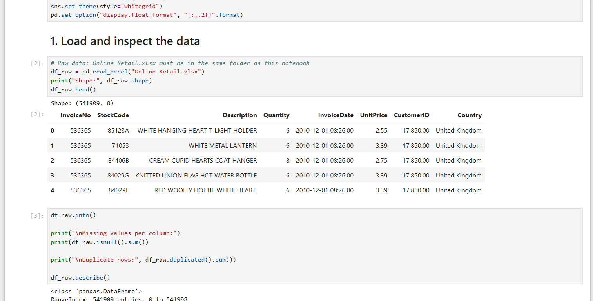
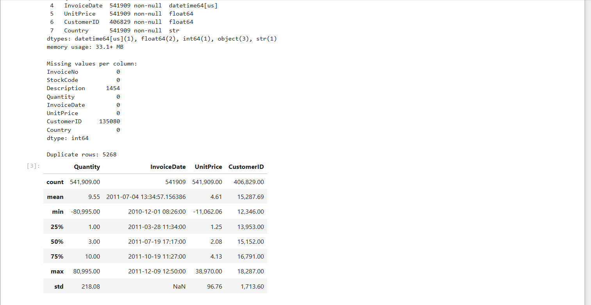
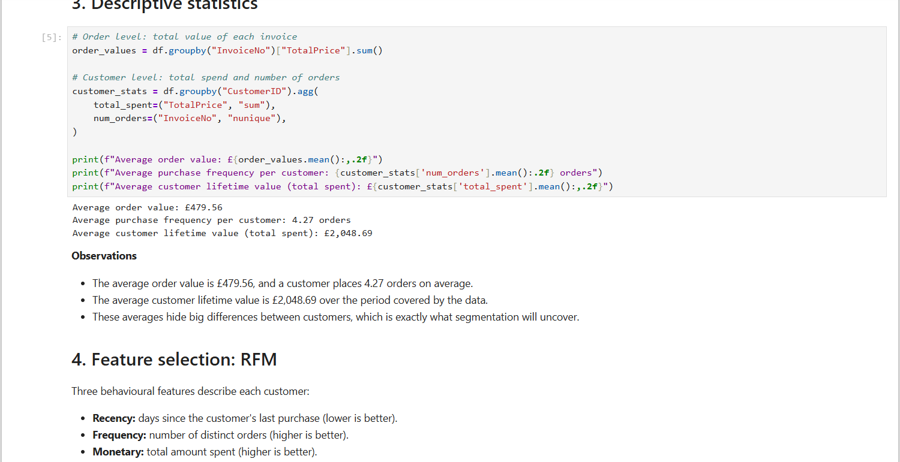
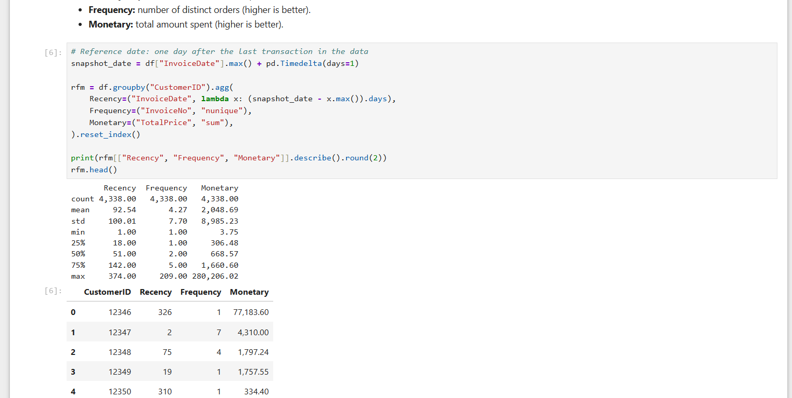
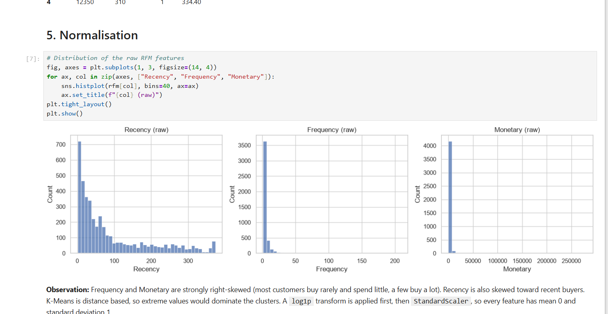
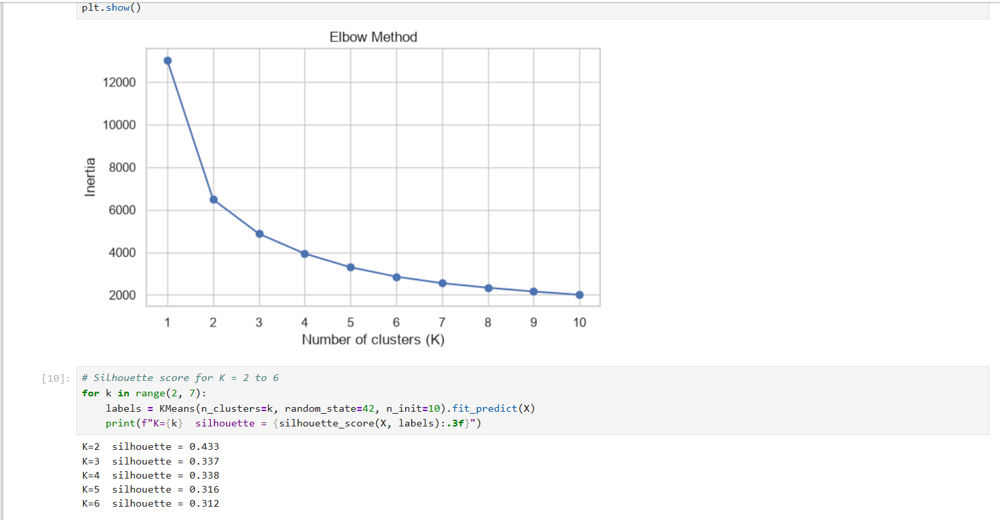
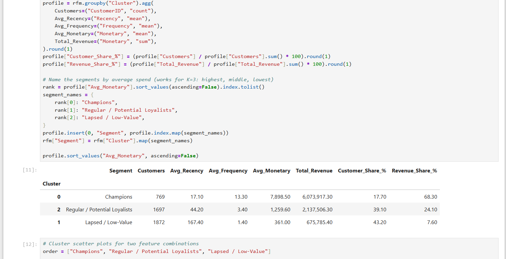
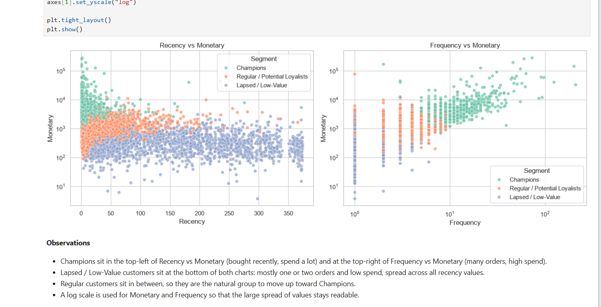
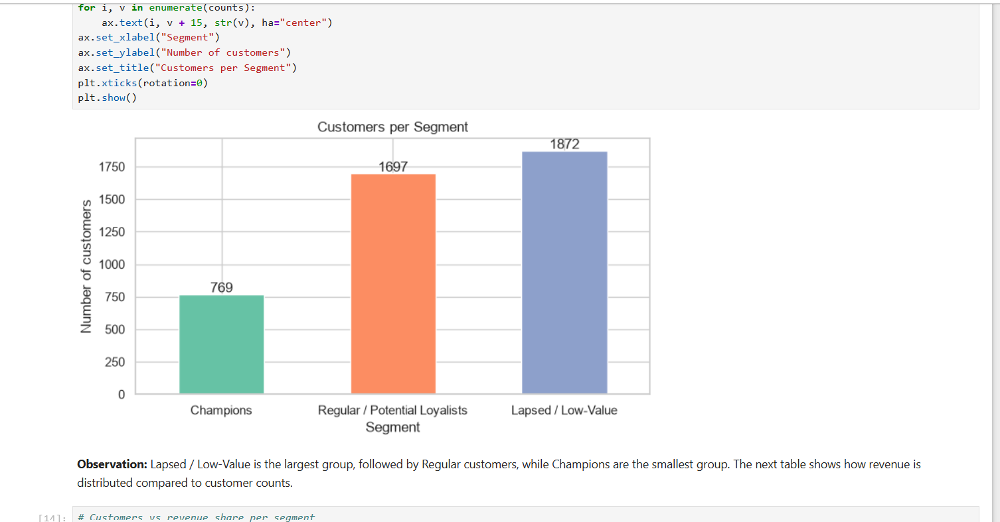
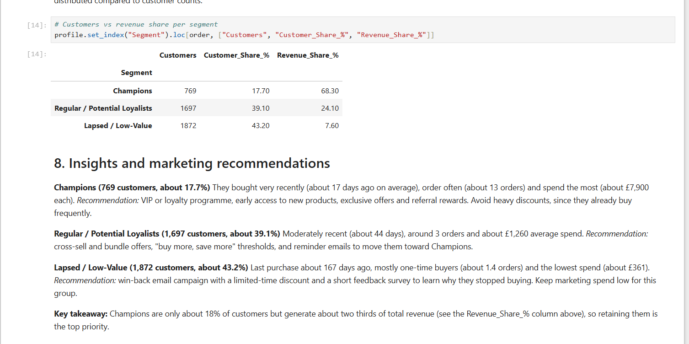

# Customer Segmentation Analysis (RFM + K-Means)

Segmentation of e-commerce customers using RFM analysis and K-Means clustering, ending with a marketing recommendation for each segment.

**Internship:** Oasis Infobyte SIP | **Track:** Data Analytics | **Level 1, Task 2**

**Author:** Nimisha S

## Objective
Group customers by purchasing behaviour (Recency, Frequency, Monetary value) so that marketing can be targeted at each segment instead of treating all customers the same.

## Dataset
- **Name:** Online Retail (UCI Machine Learning Repository, CC BY 4.0)
- **Link:** https://archive.ics.uci.edu/dataset/352/online+retail
- **Size:** 541,909 transactions, 8 columns
- **Columns:** InvoiceNo, StockCode, Description, Quantity, InvoiceDate, UnitPrice, CustomerID, Country
- **Period:** 1 December 2010 to 9 December 2011 (UK-based online retailer)
- **Quality issues:** 135,080 rows without CustomerID, 5,268 duplicate rows, and cancelled or negative-quantity transactions
- **After cleaning:** 392,692 transactions from 4,338 unique customers

## Tools
Python, pandas, NumPy, scikit-learn, Matplotlib, Seaborn, Jupyter Notebook

## Analysis Steps
1. Data inspection: shape, data types, missing values and duplicates
2. Data cleaning: removed missing CustomerID, duplicates, cancelled invoices and non-positive Quantity or UnitPrice
3. Descriptive statistics: average order value, purchase frequency and customer lifetime value
4. Feature selection: RFM (Recency, Frequency, Monetary)
5. Normalisation: `log1p` transform followed by `StandardScaler`
6. Choosing K: Elbow method and silhouette scores
7. K-Means clustering (K=3), scatter plots, cluster profiling and customers per segment
8. Insights and marketing recommendations

## Key Findings
- The average order value is £479.56, a customer places 4.27 orders on average, and the average customer lifetime value is £2,048.69.
- Spending is very skewed. The median customer places 2 orders and spends £668.57, far below the mean, because a small group of customers spends a lot (maximum £280,206).
- Recency, Frequency and Monetary are all right-skewed, so a log transform was needed before scaling.
- Silhouette scores: K=2 (0.433), K=3 (0.337), K=4 (0.338), K=5 (0.316), K=6 (0.312). K=2 is too coarse for marketing and K=3 scores the same as K=4 while staying simpler, so K=3 was chosen.
- Three segments were found:

| Segment | Customers | Customer share | Avg Recency (days) | Avg Frequency | Avg Monetary (£) | Revenue share |
|---|---|---|---|---|---|---|
| Champions | 769 | 17.7% | 17.1 | 13.3 | 7,898.5 | 68.3% |
| Regular / Potential Loyalists | 1,697 | 39.1% | 44.2 | 3.4 | 1,259.6 | 24.1% |
| Lapsed / Low-Value | 1,872 | 43.2% | 167.4 | 1.4 | 361.0 | 7.6% |

- Champions are only 17.7% of customers but generate 68.3% of total revenue. Lapsed customers are 43.2% of customers but only 7.6% of revenue.

## Recommendations
1. **Champions:** VIP or loyalty programme, early access to new products and referral rewards. Avoid heavy discounting because they already buy often.
2. **Regular / Potential Loyalists:** cross-sell and bundle offers, "buy more, save more" thresholds and reminder emails to move them toward Champions.
3. **Lapsed / Low-Value:** win-back email with a limited-time discount and a short feedback survey. Keep marketing spend low for this group.
4. Make retaining Champions the top priority, since losing a few of them affects revenue the most.

## Screenshots











## Note
Segment names (Champions, Regular / Potential Loyalists, Lapsed / Low-Value) are assigned in the notebook by ranking the three clusters on average spend, so they stay consistent if the notebook is re-run.

## Files
- `customer_segmentation.ipynb`: full analysis notebook
- `Online Retail.xlsx`: dataset
- `rfm_segments.csv`: RFM values, cluster and segment for each of the 4,338 customers
- `screenshots/`: output charts and tables

## How to Run
```
pip install pandas numpy matplotlib seaborn scikit-learn openpyxl notebook
jupyter notebook customer_segmentation.ipynb
```
