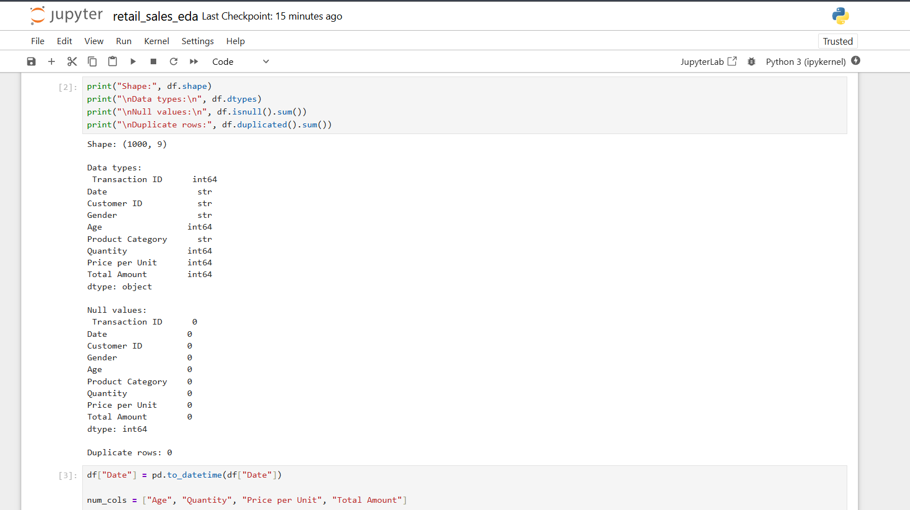
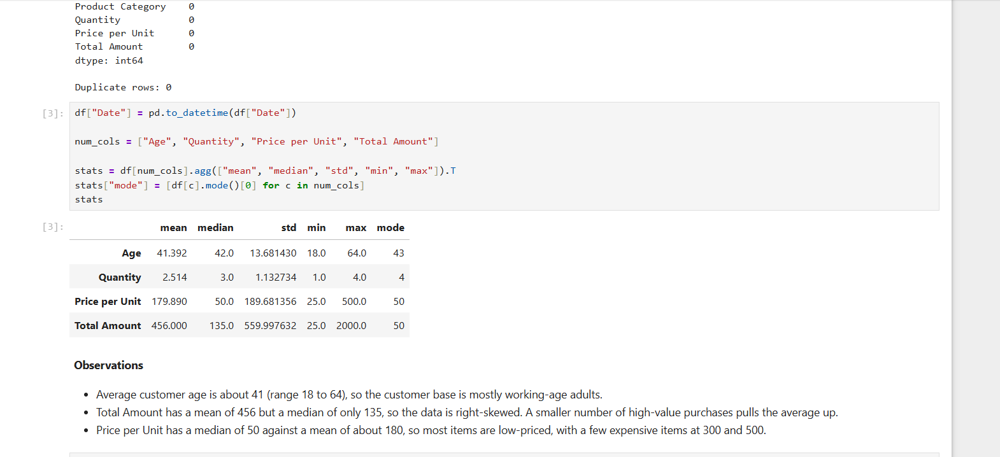
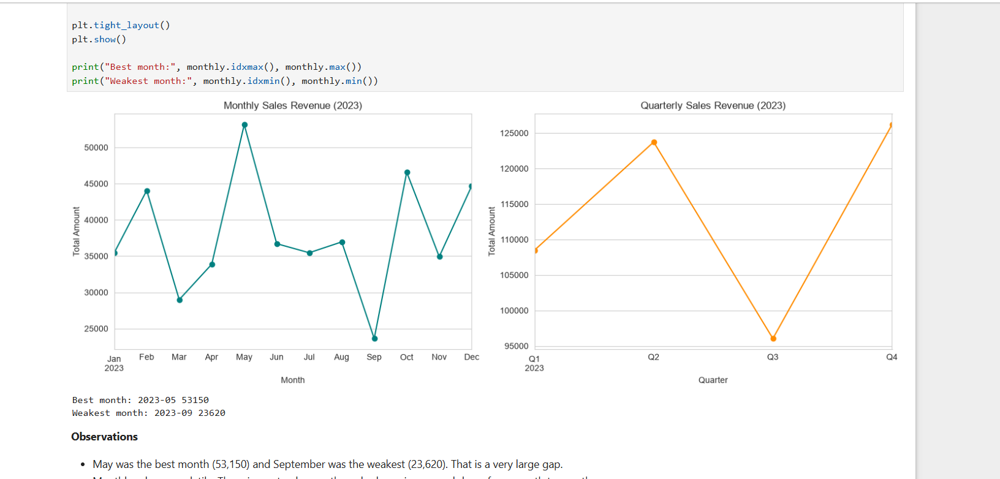
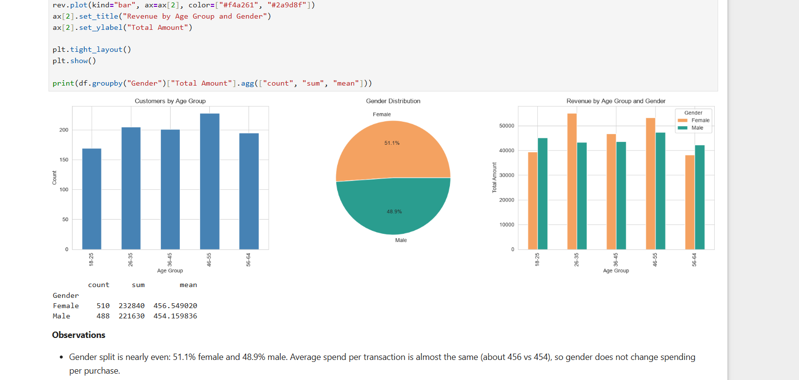
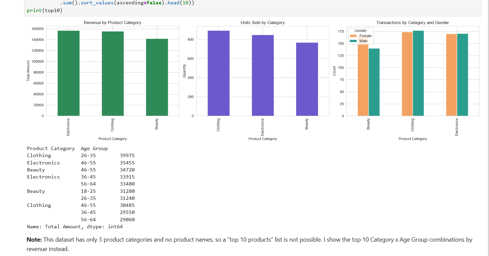
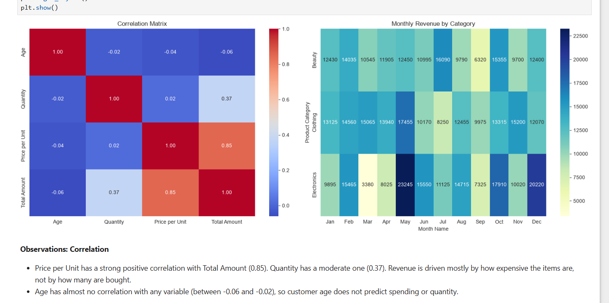

# EDA on Retail Sales Data

Exploratory Data Analysis of retail transactions to find sales trends, customer demographics and product performance, ending with actionable business recommendations.

**Internship:** Oasis Infobyte SIP | **Track:** Data Analytics | **Level 1, Task 1**

**Author:** Nimisha S

## Objective
Explore a retail sales dataset to uncover patterns in sales over time, customer behaviour and category performance, and recommend business actions based on the findings.

## Dataset
- **Name:** Retail Sales Dataset (Kaggle, by mohammadtalib786)
- **Size:** 1,000 transactions, 9 columns
- **Columns:** Transaction ID, Date, Customer ID, Gender, Age, Product Category, Quantity, Price per Unit, Total Amount
- **Period:** January 2023 to December 2023 (two records dated 1 Jan 2024 were excluded from the analysis, leaving 998 transactions)
- **Quality:** no null values and no duplicate rows

## Tools
Python, pandas, NumPy, Matplotlib, Seaborn, Jupyter Notebook

## Analysis Steps
1. Data inspection: shape, data types, null and duplicate checks
2. Descriptive statistics: mean, median, mode, standard deviation
3. Time series analysis: monthly and quarterly sales trends
4. Customer demographics: age groups and gender
5. Category analysis: revenue and units sold by category, top 10 Category x Age Group combinations
6. Correlation heatmap and an extra heatmap of monthly revenue by category
7. Conclusion with business recommendations

## Key Findings
- Sales are highly seasonal. May is the best month (53,150) and September the weakest (23,620). Q2 and Q4 are the strongest quarters and Q3 is the lowest.
- Gender split is nearly even (51.1% female, 48.9% male) and average spend per transaction is almost the same. Women generate slightly more total revenue.
- The 46-55 age group has the most customers. Clothing for ages 26-35 is the best-performing segment.
- Electronics earns the most revenue, Clothing sells the most units, and Beauty is lowest.
- Price per unit strongly drives Total Amount (correlation 0.85). Age has almost no correlation with spending.
- Electronics is the most volatile category (peak in May, very low in March). September is weak in all three categories.

## Recommendations
1. Run promotions and bundles in the Q3 slump (July to September).
2. Time Electronics campaigns for May, October and December, and investigate the March dip.
3. Target Clothing at ages 26-35, and Electronics and Beauty at ages 46-55.
4. Use premium items and upselling to raise order value, since price per unit drives revenue.
5. Run gender-focused campaigns for Beauty, which women buy more.

## Screenshots







## Note
The dataset has only 3 product categories and no product names, so the "top 10 best-selling products" analysis uses the top 10 Category x Age Group combinations by revenue instead.

## Files
- `retail_sales_eda.ipynb`: full analysis notebook
- `retail_sales_dataset.csv`: dataset
- `screenshots/`: output charts

## How to Run
```
pip install pandas numpy matplotlib seaborn notebook
jupyter notebook retail_sales_eda.ipynb
```
