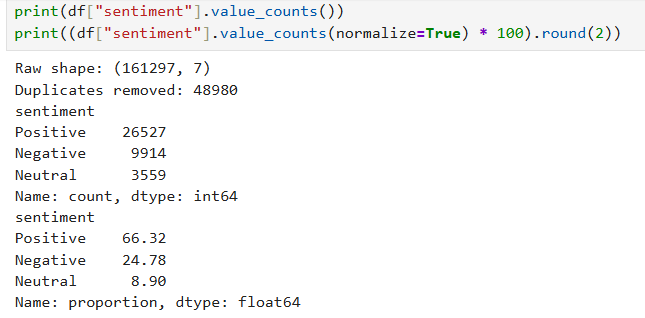
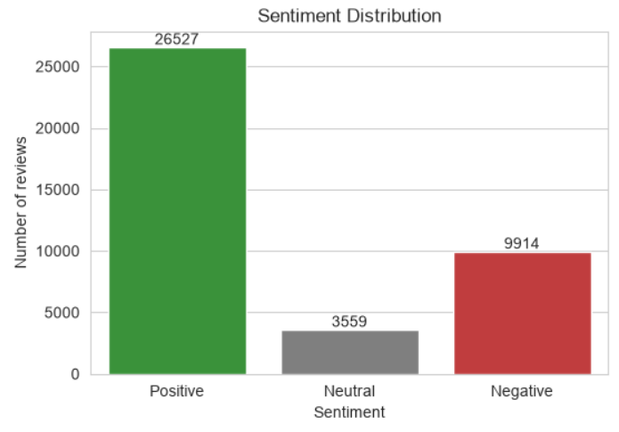
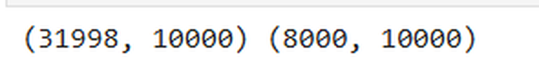
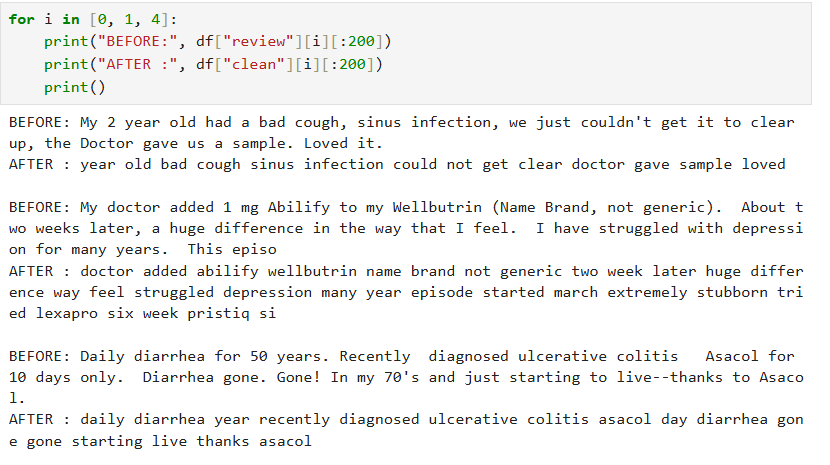
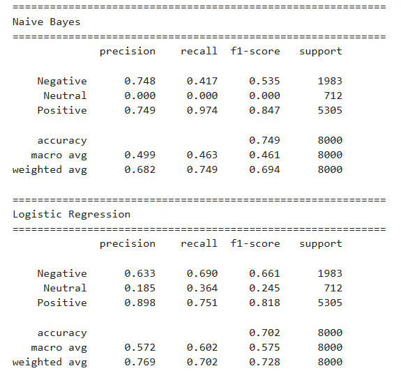
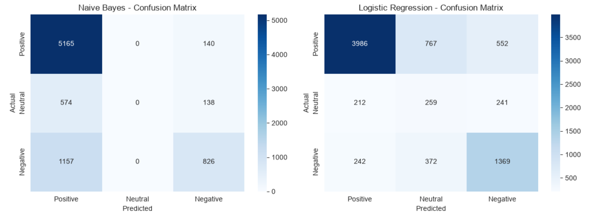
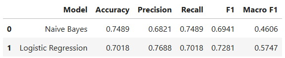
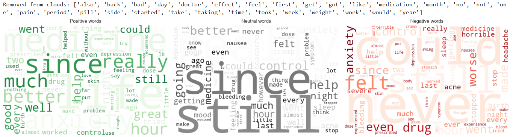
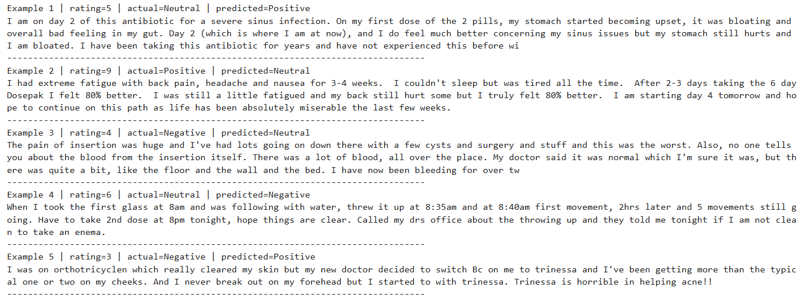

# Sentiment Analysis of Patient Drug Reviews

Classifying patient drug reviews as Positive, Neutral or Negative using TF-IDF with Naive Bayes and Logistic Regression, followed by an error analysis of the misclassified reviews.

**Internship:** Oasis Infobyte SIP | **Track:** Data Analytics | **Level 1, Task 4**

**Author:** Nimisha S

## Objective
Build a machine learning model that classifies the sentiment of text data (Positive, Neutral, Negative), compare two classifiers, and explain where and why the model fails.

## Dataset
- **Name:** UCI ML Drug Review Dataset (Drugs.com), file `drugsComTrain_raw.csv`
- **Source:** https://archive.ics.uci.edu/dataset/462/drug+review+dataset+drugs+com
- **Size:** 161,297 reviews, 7 columns (drugName, condition, review, rating, date, usefulCount, uniqueID)
- **Labels:** derived from the 10-star rating: 7-10 Positive, 5-6 Neutral, 1-4 Negative. These are rating-derived labels, not manually annotated.
- **Cleaning:** HTML codes such as `&#039;` decoded, 48,980 duplicate reviews removed before splitting (to avoid data leakage), then a stratified sample of 40,000 reviews was used for speed
- **Class distribution of the sample:** Positive 26,527 (66.3%), Negative 9,914 (24.8%), Neutral 3,559 (8.9%)
- **Citation:** Grasser, F., Kallumadi, S., Malberg, H., Zaunseder, S. (2018). Drug Review Dataset (Drugs.com). UCI Machine Learning Repository.

## Tools
Python, pandas, NumPy, scikit-learn, NLTK, Matplotlib, Seaborn, WordCloud, Jupyter Notebook

## Analysis Steps
1. Data loading, HTML decoding, duplicate removal, rating-to-sentiment labelling and class distribution check
2. Text preprocessing: lowercase, `n't` expanded to `not`, URL/punctuation/number removal, tokenisation, stopword removal (kept "not", "no", "nor"), lemmatisation
3. TF-IDF features (10,000 features, unigrams and bigrams), fitted on the training set only
4. Stratified 80/20 train/test split (31,998 train, 8,000 test)
5. Two models: Multinomial Naive Bayes and Logistic Regression (`class_weight="balanced"`)
6. Evaluation: accuracy, precision, recall, F1, Macro F1 and confusion matrices
7. WordClouds for each sentiment class
8. Error analysis of 5 misclassified reviews
9. Conclusion

## Results

| Model | Accuracy | Weighted F1 | Macro F1 | Neutral Recall |
|---|---|---|---|---|
| Naive Bayes | 0.749 | 0.694 | 0.461 | 0.000 |
| Logistic Regression | 0.702 | 0.728 | 0.575 | 0.364 |

## Key Findings
- The data is imbalanced (Positive 66.3%, Negative 24.8%, Neutral 8.9%), so accuracy alone is misleading.
- Naive Bayes has the higher accuracy (0.749) but never predicts the Neutral class. Logistic Regression has the better Macro F1 (0.575) and detects more Negative reviews (recall 0.690 vs 0.417), so it is the best model overall.
- Neutral is the hardest class for both models. Logistic Regression reaches a Neutral recall of 0.364 but a precision of only 0.185.
- Logistic Regression misclassified 2,386 of 8,000 test reviews (29.8%). The most common mistakes are between Positive and Neutral.
- Main causes of errors: mixed sentiment in one review, symptom words describing the illness rather than the drug, borderline ratings, several drugs in one review, and TF-IDF ignoring word order.

## Recommendations
1. Judge models on Macro F1 and per-class recall, not accuracy, when classes are imbalanced.
2. Use a class-weighted model such as Logistic Regression when the goal is to catch negative feedback and side-effect complaints.
3. Collect manually labelled Neutral reviews, because rating-derived labels are noisy around ratings 4-6.
4. Try ComplementNB, SVM or transformer models (BERT) to handle context, negation and reviews that mention several drugs.

## Screenshots










## Note
The labels come from star ratings, so a review can disagree with its rating (for example, a 6/10 review that sounds negative). Some "errors" in the error analysis are therefore label noise rather than model failure. The dataset file is not included in this repository because of its size (83 MB); download it from the link above and place `drugsComTrain_raw.csv` next to the notebook.

## Files
- `Sentiment_Analysis.ipynb`: full analysis notebook
- `screenshots/`: output charts and tables

## How to Run
```
pip install pandas numpy scikit-learn nltk matplotlib seaborn wordcloud notebook
jupyter notebook Sentiment_Analysis.ipynb
```
NLTK data (stopwords, punkt, wordnet) downloads on the first run.
